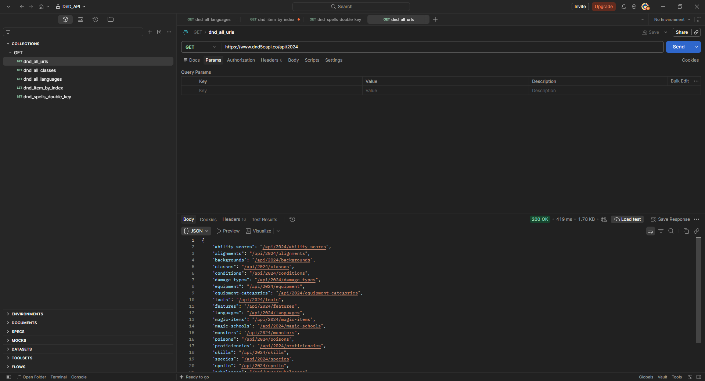
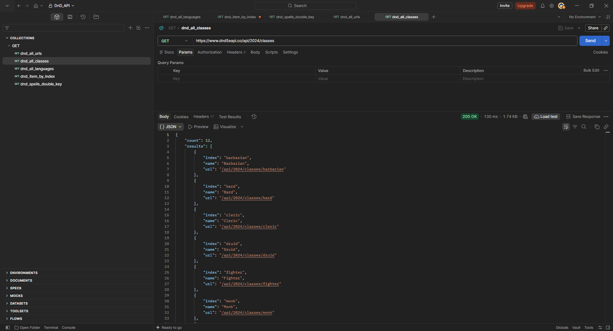
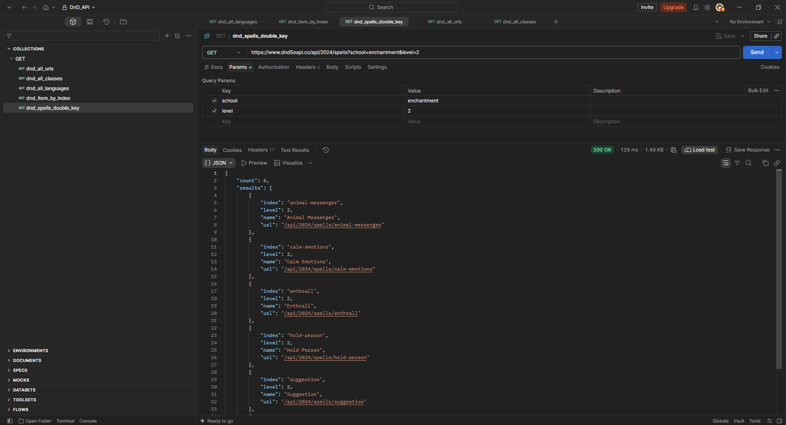
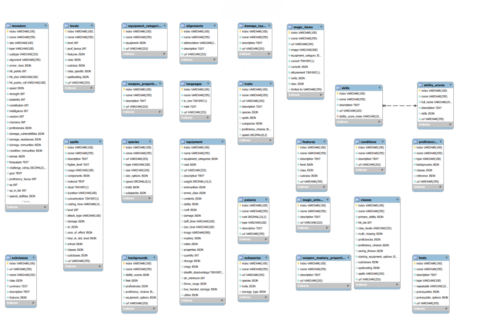
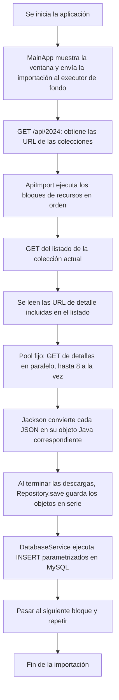

# DND API


## 1. Introducción

### 1.1. Descripción general

Este proyecto consiste en una aplicación de escritorio desarrollada en Java que
consulta la [D&D 5e API](https://www.dnd5eapi.co/) y almacena/consulta sus
recursos en una base de datos MySQL. La interfaz gráfica está desarrollada con
JavaFX y permite seleccionar tablas, consultar sus registros y filtrar los
resultados.

La aplicación trabaja principalmente con recursos de Dungeons & Dragons, como:

- Clases, subclases, niveles y rasgos.
- Especies, subespecies y habilidades.
- Monstruos, hechizos y objetos mágicos.
- Equipo, competencias, condiciones y tipos de daño.
- Alineamientos, trasfondos, dotes, idiomas y venenos.

La comunicación con la API externa se realiza mediante peticiones HTTP `GET` a
`https://www.dnd5eapi.co/api/2024`. Los datos se transforman desde JSON a
objetos Java y se persisten en las tablas definidas en
[`tables.sql`](src/main/resources/tables.sql).

### 1.2. Tecnologías utilizadas

| Tecnología | Uso |
|---|---|
| Java 21 | Lenguaje y ejecución del proyecto |
| JavaFX 11 | Interfaz gráfica |
| MySQL | Persistencia de datos |
| Maven | Gestión del proyecto y dependencias |
| Jackson | Conversión de JSON a objetos Java |
| SLF4J y Logback | Registro de actividad y errores |
| D&D 5e API | Fuente externa de información || Common-csv | Exportación a csv |

### 1.3. Capturas de Postman

#### Petición 1: listado de recursos

 
- **Método:** `GET`
- **URL:** `https://www.dnd5eapi.co/api/2024`
- **Respuesta esperada:** `200 OK`
- **Explicación:** muestra los endpoints disponibles en la versión 2024 de la API.

#### Petición 2: consulta de un recurso


- **Método:** `GET`
- **URL:** `https://www.dnd5eapi.co/api/2024/classes`
- **Respuesta esperada:** `200 OK`
- **Explicación:** muestra el JSON classes de la API.

#### Petición 3: prueba usando keys school y level



- **Método:** `GET`
- **URL:** `https://www.dnd5eapi.co/api/2024/spells?school=enchantment&level=2`
- **Respuesta esperada:** `200 OK` 
- **Explicación:** muestra el filtrado de los objetos spell usando las keys school y level.

## 2. Diagrama ER de la base de datos



### 2.1. Resumen del modelo

- Cada tabla utiliza normalmente el campo `index` como clave primaria.
- Las tablas contienen recursos de la API y sus atributos principales.
- Parte de las relaciones procedentes de la API se conserva en columnas `JSON`
  (por ejemplo, clases, proficiencias, equipo o acciones de monstruos).

## 3. Manual técnico para desarrolladores

### 3.1. Requisitos previos

- JDK 21.
- Maven.
- Servidor MySQL en ejecución.
- Base de datos `dnddatabase`.
- Credenciales configuradas en
  [`config.properties`](src/main/resources/config.properties).

### 3.2. Instalación y configuración

1. Clonar el repositorio.

2. Revisar la URL, usuario y contraseña en
   [`config.properties`](src/main/resources/config.properties).
   La propiedad `database.init.tables=true` indica que, al iniciar la
   aplicación, se ejecuta [`tables.sql`](src/main/resources/tables.sql) y se
   crean automáticamente las tablas del esquema mediante `CREATE TABLE IF NOT
   EXISTS`. Por tanto, no es necesario crear manualmente cada tabla.
3. Descargar las dependencias y compilar:

   ```bash
   mvn clean package
   ```

4. Ejecutar la aplicación:

   ```bash
   mvn javafx:run
   ```

   Al ejecutar el `main`, se inicializa la conexión con MySQL y se crea el
   esquema de tablas si todavía no existe. Después se inicia la importación de
   datos de la API en segundo plano.

### 3.3. Estructura principal

| Paquete o archivo | Responsabilidad |
|---|---|
| `api` | Cliente HTTP para consultar la D&D 5e API |
| `model` | Clases que representan las respuestas y recursos JSON |
| `service` | Importación y lógica de aplicación |
| `database` | Conexión, creación de tablas y operaciones CRUD |
| `repository` | Acceso organizado a los recursos persistidos |
| `controller` | Eventos y comportamiento de la interfaz JavaFX |
| `resources/fxml` | Vistas de la aplicación |
| `resources/tables.sql` | Definición de las tablas de MySQL |

### 3.4. Flujo técnico de una consulta

1. El `main` lanza JavaFX y carga la vista principal.
2. `DatabaseService` abre la conexión y crea el esquema de tablas desde
   `tables.sql` cuando `database.init.tables=true`.
3. La aplicación inicia la importación de datos de la API.
4. El usuario selecciona una tabla en la interfaz.
5. `MainMenuController` solicita los datos a `DatabaseService`.
6. `DatabaseService` ejecuta la consulta usando `PreparedStatement`.
7. El resultado se transforma en filas y se muestra en un `TableView`.
8. El campo de búsqueda filtra las filas cargadas sin repetir la consulta.


### 3.5. Flujo de llamadas a la API y guardado en MySQL

`MainApp` muestra la ventana y lanza la importación en segundo plano. Los bloques
de recursos se procesan en orden. Solo las descargas de detalle son paralelas
(hasta 8 a la vez); los guardados en MySQL se ejecutan en serie.



En un bloque con datos relacionados, primero se guarda el registro principal y
después se consulta su listado asociado de forma secuencial. Sus detalles usan el
mismo pool de hasta 8 hilos y se guardan en serie antes de continuar.

Al crear el primer repositorio se inicializa `DatabaseService`, que prepara la
base de datos y la conexión; las tablas se crean desde `tables.sql` si está
activada esa opción.

## 4. Manual de usuario y juego de pruebas

### 4.1. Puesta en marcha

1. Iniciar MySQL.
2. Comprobar la configuración de conexión.
3. Ejecutar la aplicación.
4. Seleccionar una tabla del panel lateral.
5. Revisar los registros mostrados.
6. Utilizar el campo de búsqueda para filtrar los resultados.

## 5. Reparto de tareas y uso de IA

### 5.1. Reparto de tareas

| Integrante | Tareas realizadas ||
|---|---|---:|
| **Xián Morales** | Exportación CSV/JSON, Diagrama ED, Conexión API, Tablas de la BD |
| **Pablo González Temes** | Memoria y documentación, Interfaz y controladores javafx, panel kanban |
| **Trabajo conjunto** | Diseño de interfaz de javafx, Peticiones postman, volcado de datos, casos test, CRUD, código de model y repository
|

### 5.2. Uso de IA

En este proyecto se ha usado la IA para asistir en las partes que no dominábamos como las corrutinas, el apartado visual (javafx/css), controller, código boilerplate y como consultor acerca de como mejorar el rendimiento del volcado.


## 6. Propuestas de mejora

- Cambiar los campos JSON por relaciones entre tablas.
- Mejora de la interfaz de usuario buscando las siguiente mejoras:
  - Accesibilidad.
  - Claridad visual.
  - Diferenciación en el apartado visual de cada tabla.
- Mejora del tiempo de volcado de datos.
- Añadir información sobre el estado del volcado en la interfaz gráfica.
- Comprobación de la existencia de los datos.
- Añadir las siguientes funcionalidades:
  - Creación de personajes.
  - Exportación e importación de personaje (usando semilla o archivo).

## 7. Conclusiones, dificultades y opinión del trabajo realizado

### 7.1. Conclusiones

Este proyecto ha sido una buena forma de aprender como no hacer un desarrollo. Hemos cometido errores clave en nuestra metodología de trabajo ya que no optamos por el prototipado e intentamos hacer una versión completa desde el principio. Esto nos llevó a errores que costarían tiempo crucial para el desarrollo de la aplicación, lo que desembocaría en un producto final que no ha alcanzado el potencial total que podría tener.

A pesar de todo esto este proyecto nos ha servido para experimentar las dimensiones que pueden abarcar los proyectos mas grandes (gran cantidad de archivos, muchos datos por tratar, como distribuir mucha información en una interfaz...). Por último quiero destacar la lección obtenida acerca de como enfocar el desarrollo para poder evitar cometer estos errores otra vez en las próximas aplicaciones que desarrollemos.


### 7.2. Dificultades durante el desarrollo

En el desarrollo de esta aplicación hemos encontrado tres dificultades clave:
- Creación de la base de datos y las relaciones entretablas.
- Gran Volumen de datos
- Tiempo de procesamiento ETL


### 7.3. Dedicación temporal y cualificación estimada

| Concepto | Dato |
|---|---|
| Fecha de inicio | 27/10/2026 |
| Fecha de finalización | 07/10/2026 |
| Horas totales estimadas | 70 horas* |
| Horas de Xian | 35 horas* |
| Horas de Pablo | 35 horas* |
| Cualificación estimada | 7 / 10 |

\* Las horas cuantificadas excluyen el tiempo de trabajo en el centro educativo.

#### Justificación de la cualificación
La aplicación cumple con todos los requisitos obligatorios indicados en la entrega pero creemos que algunos (sobre todo el de las relaciones entre las tablas) podrían estar mejor y quizá realizar un CRUD mas elaborado y no tan simple.